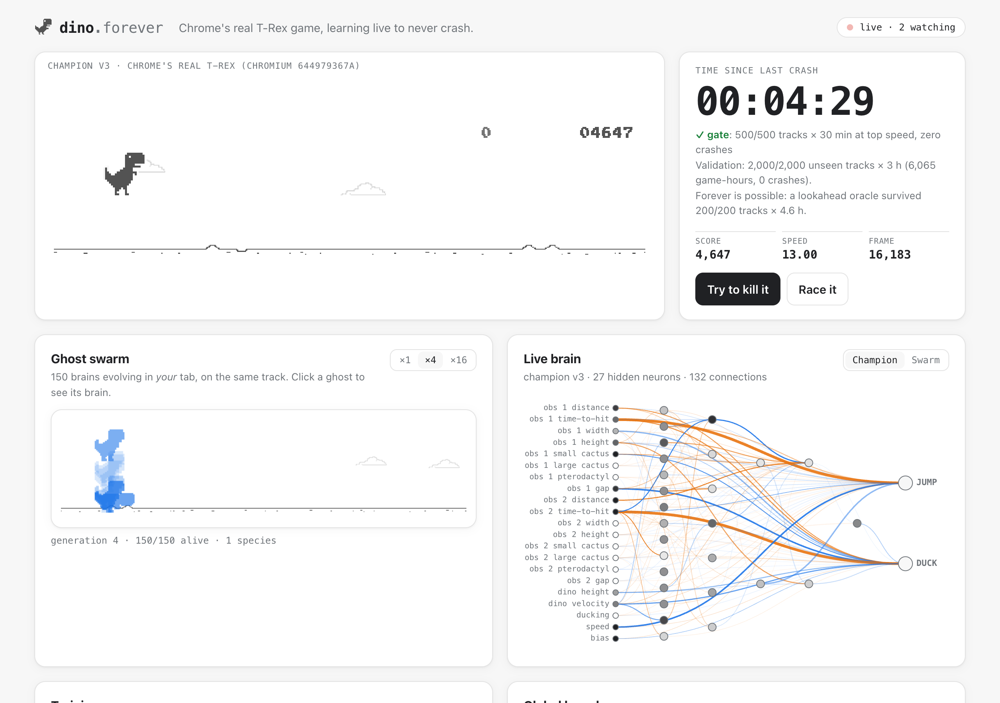

# dino.forever

**Chrome's real T-Rex game, playing itself live, learning from every crash until it never crashes.**

### ▶ [Watch it live](https://kumarganduri14.gitlab.io/chrome-dino)



## Three ways to watch

Open the link above; nothing to install.

1. **The shared live run** (top of the page).
   - One run of Chrome's dino, **started Sep 29, 2026 at 02:45 (UTC+4) and never stopped**. Everyone sees the same run at the same moment, with the same *time since last crash* clock and the same score.
   - No server or open tab is needed: your browser computes the run from its seed and the clock, starting from the latest hourly checkpoint.
   - It was simulated ahead and verified crash-free for the following week ([how](#one-shared-run-no-server-needed)).
2. **Literal `chrome://dino`, live from one machine** (the panel below it).
   - A real Google Chrome tab on `chrome://dino`, played by the same brain with Chrome's real clock and randomness, streamed live from one computer.
   - It can't be recomputed elsewhere, so it appears only while that computer streams. On strict networks it switches to a 1-frame-per-second compatibility mode.
3. **Your own fresh run.** Press **Start a fresh run** to watch the champion begin a brand-new random track from zero, in your browser only. **Back to the shared run** returns to the shared one.

The brain sees only what's on screen (the next obstacles, its height, the speed) and presses jump or duck. It never knows the future.

## Highlights

- **It's the real game.** Chromium's own T-Rex runner source (`components/neterror/resources/dino_game`), pinned at commit `644979367a` and unedited. Not a clone.
- **A tiny brain learns it.** NEAT (neuroevolution of augmenting topologies) in a few hundred lines of TypeScript. No ML framework, zero runtime dependencies.
- **Every crash becomes a lesson.** Each crash is recorded 3 seconds before impact. The trainer replays those moments until the brain clears them.
- **"Never crashes" is proven, not claimed.** A brain is promoted only after surviving **500 fresh tracks × 30 minutes at top speed with zero crashes**, and every past crash. A lookahead oracle separately shows that running forever is physically possible in Chrome's dino.
- **Everyone watches the same run.** Every browser re-simulates the identical game frame for frame from a seed and a checkpoint, so the *time since last crash* clock is shared by all viewers.
- **You can try to kill it.** Choose which obstacles Chrome spawns next. With the optional live server, attacks are replayed and verified, and a verified kill goes on a global board and into the training data.

### Running the literal chrome://dino stream (operator notes)

```bash
node scripts/real-chrome-live.mjs --port 8090                  # real Chrome tab + stream
cloudflared tunnel --no-autoupdate --url http://localhost:8090  # public https address
```

Put the printed `https://….trycloudflare.com` address in `web/config.js` (`DINO_REAL_CHROME`) and push. The machine must stay on, awake and online; the address changes whenever the tunnel restarts.

## Results (measured, not claimed)

| Test | Result |
|---|---|
| **Promotion gate**: champion v3 on 500 fresh tracks × 30 min at top speed | **500 / 500**, zero crashes |
| **Every past crash** (360 lessons, 3 s before impact) | **360 / 360** cleared |
| **Held-out validation**: 2,000 unseen tracks × 3 h at top speed | **2,000 / 2,000**, 6,065 game-hours, zero crashes |
| **Is forever even possible?** Lookahead oracle, 200 tracks × 4.6 h | **200 / 200**, no unclearable obstacle sequence found |
| **Literal chrome://dino** in Google Chrome 154, real time and real randomness | 20 min, zero crashes, score 23,108 (live demo, not replayable) |
| **Determinism**: Node vs Chrome vs Firefox vs WebKit | identical per-frame state, sense and key hashes |

Honest notes:
- **v4 is not published.** It passed every gate stage, including 1,000/1,000 held-out tracks, but then crashed 5 times in 2,000 unseen 3-hour runs. v3 stays published, and `trainer/publish.ts` now only replaces the champion with one whose 2,000-track validation is perfect.
- **v1 wasn't perfect.** It passed the gate but crashed once in 6,062 game-hours of held-out play: it jumped into a high pterodactyl. Promotion now also requires 1,000 fresh held-out tracks × 60 min.
- **Tallies:** training has simulated **25+ billion frames** over **2,700+ generations** on one laptop.

## One shared run, no server needed

Everyone who opens the page sees **the same run**, which started on **Sep 29, 2026 at 02:45 (UTC+4)**. It keeps going with no server and no tab open anywhere.

- **Why it works:** the run is fully determined by its seed and the champion's brain, and the current frame by the wall clock.
- **Proven in advance:** `trainer/shared-run.ts` simulated the run ahead of time and verified it **crash-free through Oct 6, 2026** (score ≈ 13.5 million by then). It also matched all 41 checkpoints saved by the live server that had been playing the same run, bit for bit.
- **On page load:** each browser loads the latest hourly checkpoint (`web/data/live/`) and fast-forwards headlessly to "now", in well under a second.
- **Background tabs:** browsers pause them; on return, the page catches up the same way.
- **Kept honest:** `test/shared-run.test.ts` checks in CI that the checkpoints chain into one continuous run of the published champion.

## What's on the page

| | |
|---|---|
| **Champion** | Chrome's game, drawn by Chrome's own code, played by the champion brain. Opens with zero clicks. |
| **Time since last crash** | The live run's age. It only resets if the champion ever crashes. |
| **Ghost swarm** | 150 brains evolving in *your* tab on one shared track, dying off wave by wave. Click a ghost to see its brain. |
| **Live brain** | The network with its activations: inputs (distance and time to the next obstacles, their shape, the dino's height, speed) → hidden neurons → JUMP / DUCK. |
| **Training** | Best and mean fitness per generation from the headless trainer, with champion promotions marked. |
| **Crash black box** | Every recorded crash. Click one to replay the 3 seconds before impact exactly, at half speed. |
| **Global board** | Longest survival, top killers, fastest humans. Every entry is re-played by the server before it counts. |
| **Try to kill it / Race it** | Attack the champion with legal obstacles, or race a ghost of it on the same track. |

## How it works

```
                vendor/chromium-dino/*.ts   (unedited, pinned 644979367a, BSD-3)
                              │
            build.mjs (esbuild): chrome://resources imports → src/hook/stubs
                                 device flags (mobile/iOS/hi-dpi) → pinned
                              │
   ┌──────────────────────────┼────────────────────────────┐
   ▼                          ▼                            ▼
 trainer/ (Node, 10 cores) server/ (Fly.io)            public/ (GitLab Pages)
 NEAT + curriculum         live run + checkpoints      champion · swarm · brain
 endurance gate            SSE · verify every claim    chart · graveyard · board
   │  champion, history  ▲    │ seed + checkpoint          ▲
   └──── trainer/sync.ts ─┘    └──────── /api/live ─────────┘
              ▲ lessons (live crashes, verified kills)
```

**Determinism is the foundation.** Chrome's runner reads the clock (`performance.now`) and dice (`Math.random`) every frame. `src/hook` owns both: every game steps exactly 1/60 s with a seeded PRNG, and the device flags are pinned. A run is fully described by `(seed, key presses)`, so:
- a crash can be replayed from a 3-second-earlier snapshot;
- the server can verify any claim by re-simulating it;
- every visitor sees the same live run without receiving a single frame.

The test suite checks that Node, Chrome, Firefox and WebKit produce **identical per-frame state hashes**. It also checks that our DOM-free construction of Chrome's `Runner` matches Chrome's own `Runner.initializeInstance()` page init, frame for frame.

**The brain** sees 20 numbers each frame. It holds two keys, exactly the way a player would: JUMP (hold length sets jump height) and DUCK (fast-fall when airborne).

**Training** is standard NEAT (speciation, innovation numbers, crossover, add-node and add-connection mutations), plus:
- **Curriculum:** every crash of each generation's best genome is saved 3 s before impact, and a sample of those saved crashes is replayed each generation.
- **Hard-example mining:** whatever made the last endurance gate fail is trained on every generation until it passes.
- **Endurance gate:** 50 tracks, then 500 tracks × 30 min at max speed, then every stored lesson. Only then does a brain become champion.

**The oracle** is a lookahead planner that forks the real game and tries each action. It isn't the player; it's the yardstick for whether "forever" is even possible. It also decides whether a visitor's kill was fair: an attack only counts if the oracle can survive that same obstacle sequence.

## Run it locally

Requirements: Node ≥ 24 (Node runs the TypeScript directly) and Google Chrome.

```bash
npm install
npm run build                    # bundles the vendored game + site into public/
node scripts/preview.ts          # http://127.0.0.1:4173  (local mode, no server needed)
```

```bash
npm run train                    # headless NEAT on all cores; writes out/train/*.json
node trainer/publish.ts          # training results → web/data/ (what the site shows)
npm run oracle                   # feasibility sweep: 200 tracks × 1M frames
node server/main.ts              # live server on :8080; open the site with ?api=http://localhost:8080
node scripts/real-chrome.mjs     # plays the literal chrome://dino in your Chrome with the champion
```

Tests:

```bash
npm test                                      # engine, NEAT, attacks, server verification, vendor hashes
node --test test/e2e/determinism.test.ts      # Node vs Chrome vs Firefox vs WebKit
node --test test/e2e/server-http.test.ts      # the real server over HTTP
```

## Deploy

- **Pages:** every push to `main` builds `public/` and publishes it to `https://kumarganduri14.gitlab.io/chrome-dino` (`.gitlab-ci.yml`).
- **Live server:** `fly launch --no-deploy --copy-config`, then `fly volumes create dino_data --region sin --size 1`, then `fly deploy`. Or set the `FLY_API_TOKEN` CI variable and CI deploys on push.
- **Trainer ↔ server:** put `DINO_SERVER` and `DINO_DEPLOY_KEY` in `~/.dino-forever.env` and run `node trainer/sync.ts`. It uploads progress and champions, and pulls live crashes and verified kills into the curriculum.

The server runs a single `node:http` process with SQLite (`node:sqlite`), on one machine that is never auto-stopped. The live run survives restarts, because its state is a function of `(seed, checkpoint, wall clock)`.

## Layout

```
vendor/chromium-dino/   Chromium's dino, unedited (+ VENDOR.md with SHA-256 per file)
src/hook/               clock/dice/device pinning, snapshots, hashing, sense, keys, attack drops
src/engine/             Game: Chrome's Runner driven headless or onto a canvas
src/neat/               genome, network, population (NEAT)
src/oracle/             rule oracle + lookahead planner (the yardstick)
trainer/                worker pool, training loop, gate, publish, sync
server/                 live server, verification worker, SQLite
web/                    the site (vanilla TS + canvas, no framework)
scripts/                preview server, chrome://dino driver
test/                   unit + cross-engine + HTTP tests
```

## Credits

The T-Rex runner game, its sprites and code are © The Chromium Authors, BSD-3-Clause (`vendor/chromium-dino/LICENSE`). Everything else in this repository is MIT (`LICENSE`).
